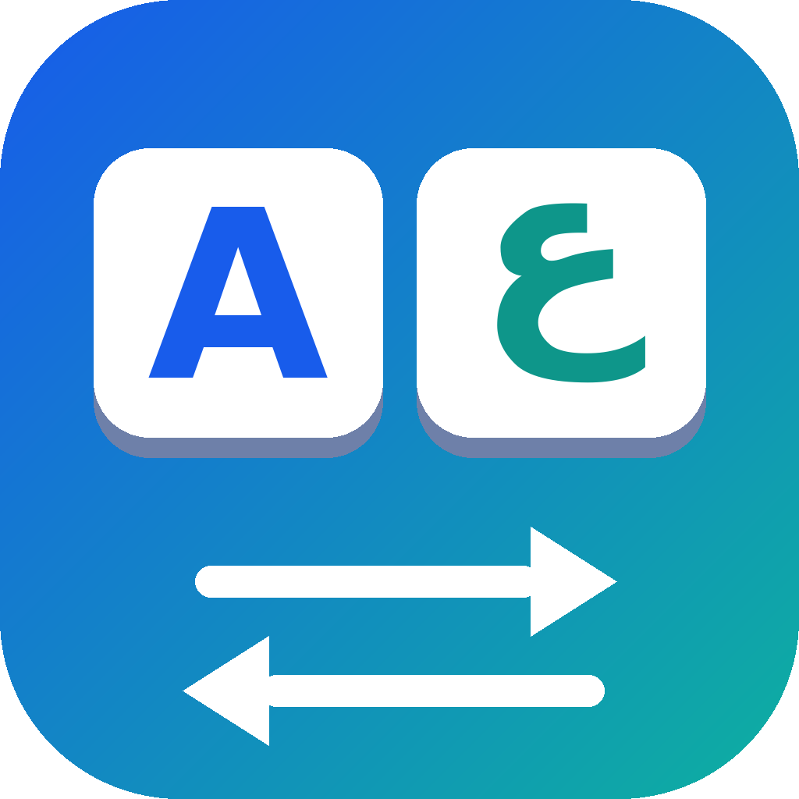

# KeyFlip

A tiny Windows tray utility that fixes text typed with the wrong keyboard layout.
Select text in any app, press a shortcut, and KeyFlip converts it between
**English (QWERTY)** and **Arabic (101)** by key position. It does not translate or spell-check.

Example: `sghl` becomes `سلام`, and `شلاخعف` becomes `about`. Pressing the shortcut again
right away puts back exactly what you had.

## Use

1. Run `KeyFlip.exe`. An icon appears near the clock (it may be under the `^` arrow).
2. Select text in any app and press the shortcut (default: **Ctrl+Alt+Space**).
3. If the shortcut is taken by another program, KeyFlip tells you. Double-click the tray icon
   and choose another one in **Settings**. Shortcuts that every program needs, such as Ctrl+C,
   Ctrl+V or Alt+F4, cannot be chosen.

Tray menu: **Settings**, **Enabled** (turn the shortcut on/off), **Exit**.

KeyFlip does not start with Windows unless you tick that box in Settings.

## Notes and limits

- Conversion follows the Windows **Arabic (101)** layout. Other Arabic layouts are not supported.
- After converting, KeyFlip switches the keyboard layout of the active window to the language of the new
  text (if that layout is installed). Turn this off with **Switch keyboard layout after converting** in Settings.
- Digits and spaces are left unchanged.
- The Arabic text "لا" looks the same whether it was typed with the `b` key or with `g` then `h`.
  When converting to English, KeyFlip uses `b` unless `gh` makes a known English word
  (for example `night`, `though`, `laugh`).
- KeyFlip copies your selection, pastes the converted text, then restores your previous clipboard.
  Text, images and file lists are restored. Some complex formats (for example from Excel) may not be,
  and KeyFlip warns you when that happens. KeyFlip keeps its own clipboard use out of the
  Windows clipboard history (Win+V), but the copy of your selection may still appear there.
- It cannot send keystrokes to programs running as administrator.
- Releases on the GitHub Releases page are meant to be code-signed (see `docs/RELEASING.md`).
  Right-click `KeyFlip.exe`, open **Properties > Digital Signatures** to check. If it is unsigned,
  or Windows SmartScreen still shows "Windows protected your PC", click **More info**, then **Run anyway**.
  Each release includes `KeyFlip.exe.sha256`; compare it with
  `Get-FileHash KeyFlip.exe -Algorithm SHA256` in PowerShell. Some antivirus tools may flag programs
  that use a global shortcut and simulated keystrokes; the full source code is included so you can check it.
- Settings are stored in `%AppData%\KeyFlip\settings.json`.

## Uninstall

Untick "Start KeyFlip when I sign in" in Settings, choose Exit, delete `KeyFlip.exe`,
and optionally delete `%AppData%\KeyFlip`.

## Build from source

Requires the .NET SDK.

```
cd KeyFlip
dotnet publish -c Release -r win-x64 --self-contained true -p:PublishSingleFile=true -p:IncludeNativeLibrariesForSelfExtract=true -p:EnableCompressionInSingleFile=true -o ..\publish
```

Run the tests with `dotnet test` in the `KeyFlip.Tests` folder.
